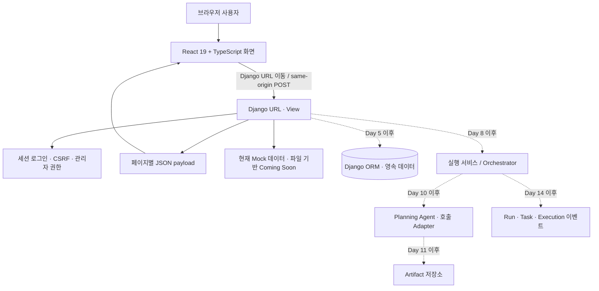

# Day 2 — 실행 경계와 환경 설정 점검

- 수행일: 2026-10-20
- 기준 문서: `기획/1. 기획안.txt`의 8장, 15-3, 15-4, 16장
- 상태: 완료

## 1. 현재 구조와 책임 경계

| 경계 | 저장소에서 확인한 책임 |
| --- | --- |
| React | `front/react`가 TSX 화면과 UI 상태를 렌더링한다. Vite 개발 서버는 `127.0.0.1:5173`, 배포용 bundle은 Django의 `front/static/react/`로 생성한다. React는 DB와 비밀값에 접근하지 않는다. |
| Django | `front/config/urls.py`와 앱 View가 서버 URL, 세션, CSRF, 관리자 검사를 수행하고 `apps.react_pages.render_react`가 화면 payload와 Vite manifest asset을 전달한다. |
| 현재 데이터 경계 | Project/Task/Agent/알림 화면은 `apps.mockdata`를 쓴다. Coming Soon만 문서 파일을 저장한다. 프로젝트 도메인 모델이나 Agent worker/orchestrator 구현은 아직 없다. |
| 예정 경계 | ORM과 소유권은 Day 3–7, 실행·멱등성은 Day 8–9, Agent provider 호출은 Day 10, 상태 이벤트·재시도는 Day 14–16에 별도 책임으로 추가한다. |

`apps/projects/views.py`는 현재 페이지 렌더링과 Chat Stub을 함께 포함한다. 실제 저장과 Agent 작업이 들어오면 UI 요청 처리, 도메인 저장, 실행 조율을 서비스 계층으로 나누되, Day 2에 선행 리팩터링은 하지 않았다.

## 2. 환경 변수와 비밀값

| 변수 / 자산 | 로컬 동작 | 운영 요구 / 상태 |
| --- | --- | --- |
| `DJANGO_DEBUG` | 미설정 시 개발 편의를 위해 `1` | 운영은 반드시 `0`으로 명시. 운영 모드에서는 아래 비밀키가 필수다. |
| `DJANGO_SECRET_KEY` | 미설정 시 최초 실행 때 임의 키를 `front/.local-django-secret`에 생성 | 운영 secret manager / 프로세스 환경변수로 주입. 코드 기본 키 제거 완료. |
| `DJANGO_ALLOWED_HOSTS` | 기본값 `127.0.0.1,localhost,testserver` | 배포 도메인만 쉼표로 지정. `*` 전체 허용 제거 완료. |
| DB | SQLite `front/db.sqlite3`, Git 제외 | 개발 DB 구조 승인·영속 모델은 Day 3–5. 운영 DB 종류·백업은 Day 18에서 결정한다. |
| Agent/API 비밀값 | 아직 실제 Provider 호출 없음 | Day 10 연결 전 별도 키·모델·호출 상한 결정. 프런트 번들에 비밀값을 넣지 않는다. |
| `.env` | Git ignore 대상이나 Django가 자동으로 불러오지 않음 | 혼동 방지를 README에 명시. 현재는 실행 환경 변수로만 주입한다. |

운영에서 `DJANGO_DEBUG=0`인데 `DJANGO_SECRET_KEY`가 없으면 `ImproperlyConfigured`로 시작을 차단한다. 로컬 생성 키와 SQLite 파일은 저장소 밖 상태로 유지된다.

## 3. 유사 Sbrain 프로젝트 참고

Sbrain은 FastAPI·React와 별도 DB/Agent 패키지를 사용하므로 프레임워크 코드나 인증을 가져오지 않았다. Day 2에서는 아래 원칙만 이 저장소 경계에 맞춰 적용했다.

- `.env.example`과 README에서 필요한 설정값과 실행 위치를 문서화하는 방식. 현재 앱은 dotenv 로더가 없으므로 `front/README.md`에 환경변수의 실제 주입 방식을 분명히 적었다.
- Agent 작업은 웹 요청·페이지 렌더링과 분리하고, 비동기 진행 상태를 저장소에 남긴다. 구체적인 worker claim 코드는 Day 8 실행 모델을 설계한 뒤에만 재사용 후보로 검토한다.
- API 테스트를 권한 격리, 동시성·중복, 오류 경계별로 쪼개는 방식을 Day 5 이후 Django 테스트에 반영한다.

## 4. Day 2 변경 및 검증

- 알려진 고정 `SECRET_KEY` 제거. 개발에서는 임의 키를 저장소 밖 파일에 한 번 생성해 재사용한다.
- `DJANGO_DEBUG=0`일 때 비밀키 설정을 강제한다.
- `ALLOWED_HOSTS=['*']`를 환경변수 기반 허용 목록으로 바꾸고 로컬 기본 호스트만 허용한다.
- `front/.gitignore`와 `front/README.md`에 로컬 키 제외 및 운영 환경 설정을 기록했다.

| 검증 | 결과 |
| --- | --- |
| Django system check | 통과 |
| Django 앱 테스트 | 15개 통과 |
| `DJANGO_DEBUG=0` + 환경변수 키·호스트 주입 | Debug 비활성화, 설정 호스트 반영 확인 |
| `DJANGO_DEBUG=0` + 키 미설정 | 시작 거부 및 `DJANGO_SECRET_KEY` 설정 오류 확인 |
| 로컬 Django `/login/` | HTTP 200 |
| local key ignore | 생성 파일이 Git ignore 규칙에 걸리는 것 확인 |

## 5. 남은 결정과 다음 단계

- 운영 DB·파일 저장소, 호스트·HTTPS, OAuth 및 외부 Provider는 아직 미정이다. MVP 운영값은 기획안 15-4와 Day 18에서 확정한다.
- Day 3에서는 DBML 핵심 실행 경로와 현재 빈 `apps/projects/models.py`를 대조해 필요한 모델·관계·소유권을 정리한다. 오늘은 모델·마이그레이션을 만들지 않았다.
- Day 1 브라우저 캡처 시각 검수는 CUA 런타임 경로 오류로 여전히 미완료다. 실제 화면 캡처를 확보할 수 있을 때 별도 회귀 검수한다.
