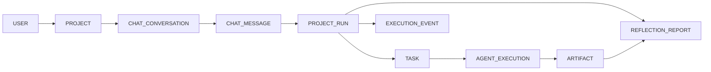

# Day 3 — 핵심 데이터 계약 검토

- 수행일: 2026-10-20
- 기준 문서: `기획/1. 기획안.txt` 15-2, 16장; `기획/2. 초기 DB 설계, DBML(dbdiagram.io).txt`
- 상태: 완료 (MVP 데이터 계약 제안, DB 적용은 미수행)

## 1. 핵심 데이터 흐름



핵심 경로는 **User → Project → Conversation → Message → Run → Task → Execution → Artifact → Reflection**이다. Run 이벤트는 Execution 전후와 별도로 Run에 직접 연결할 수 있다. Worker 결과가 없거나 오류인 경우에도 Run과 이벤트는 추적 가능해야 한다.

## 2. 발견한 DBML 간극과 변경

기존 DBML은 주요 엔티티와 40개 FK 관계를 갖고 있었지만, Project 소유자·Task/Run 관계와 몇몇 핵심 필드가 nullable이었다. 또한 ID 형식이 Django의 `BigAutoField`와 일치하지 않았고 최신 설계라고 설명하는 `erd.svg` 파일이 저장소에 없었다.

- 모든 PK/FK ID를 `bigint`로 맞추고 PK에 `increment`를 표시했다. 사용자 `requested_by`, `updated_by` FK도 대상 PK와 같은 타입으로 통일했다.
- User에 서버 발급 `identity_key`를 추가하고 unique·not null로 설정했다. 이메일은 선택값이며 고유값을 사용하되 소유권 식별자로 사용하지 않는다.
- Project의 소유 사용자, 이름, 상태, 생성·수정 시간을 필수로 설정하고 사용자별 목록 인덱스를 추가했다.
- Conversation과 Message의 소속 및 작성 시각을 필수화하고 시간순 조회 인덱스를 추가했다.
- Run은 Project·요청자·Conversation·원본 Message를 필수로 연결하고 idempotency 복합 unique를 유지했다. Project별 생성 시각 인덱스도 추가했다.
- Task는 Project와 Run, 상태, 생성 시각을 필수로 연결한다. Execution과 Artifact, Reflection 결과도 MVP 흐름에서 필요한 소유·실행 관계를 필수로 정리했다.
- Run·Task·Execution의 상태값을 DBML note에 명시했다. DB 제약만으로 서로 다른 행의 `user_id`/`project_id` 일치를 보장할 수는 없으므로 서버 서비스 검증을 필수 계약으로 남겼다.

체험 사용자는 `USER.role`에 별도 `demo`로 저장하지 않는다. 프로젝트 저장이 필요한 체험 세션은 서버가 발급한 세션별 guest `identity_key`를 사용해 사용자 간 데이터가 섞이지 않게 한다. 인증 세션 만료 후 guest 데이터의 보존·삭제 시점은 Day 18 운영 정책에서 확정한다.

## 3. 소유권·연결 규칙

1. Project를 생성·조회·수정할 때 매 요청마다 `project.user_id == authenticated_user.user_id`를 확인한다.
2. Conversation의 `user_id`가 Project의 `user_id`와 같아야 한다.
3. Run의 `requested_by`와 Project 소유자가 같고, Run의 Conversation·source Message가 서로 같은 Project/Conversation에 속해야 한다.
4. Task의 `project_id`가 연결된 Run의 Project와 같아야 한다.
5. Execution은 Task에 귀속된다. Artifact·Reflection의 Project와 Run은 해당 Task/Execution이 가리키는 Project/Run과 같아야 한다.
6. 브라우저에서 받은 소유자 ID를 신뢰하지 않는다. 서버 세션에서 신원을 구해 관계를 조회·검증한다.
7. 삭제는 기본 보존(RESTRICT)으로 두고, 대화·실행·Artifact의 보존 정책을 확정하기 전 cascading delete를 추가하지 않는다.

## 4. DBML / ERD 검증

`기획/2. 초기 DB 설계, DBML(dbdiagram.io).txt`를 설계 원본으로 갱신하고 도구가 지원하는 `dbml`·`dbmlv2` 파서로 ERD를 다시 생성했다. 생성 전에는 문서가 가리키던 `기획/erd.svg`가 없어 독립 검증 스크립트가 파일 누락으로 중단되는 문제도 확인했다. 생성 후 검증 결과:

- 21개 테이블, 174개 필드, 40개 FK
- 모든 FK 참조 타입과 키 타입 일치
- DBML 필드·기본값·필수 여부·고유 인덱스와 SVG 표시 내용 일치
- FK 선의 실제 필드 행 연결, 테이블 겹침 없음
- `validation.json` 원본 해시와 검증 manifest 일치

검증 실행:

```powershell
$env:NODE_PATH = (Resolve-Path 'tmp/erd-tooling/node_modules').Path
node 기획/erd-tools/generate.cjs
python -B 기획/erd-tools/verify.py
```

Node 생성 과정은 Fontconfig cache 경로 쓰기 경고를 출력했지만 SVG·PNG 생성과 별도 검증은 성공했다. 미리보기·DOT 파일은 기존 `.gitignore`의 `tmp/` 아래에 생성된다.

## 5. 적용 경계와 검증 결과

| 항목 | 결과 |
| --- | --- |
| DBML 파싱 및 타입·FK·인덱스 검증 | 통과, 21 tables / 174 fields / 40 foreign keys |
| ERD SVG 필드·관계·겹침 검증 | 통과 |
| Django 앱 테스트 | 15개 통과 (스키마 변경은 아직 Django에 적용하지 않음) |
| Django migration / 운영 DB 변경 | 미실행. DBML은 설계이며 실제 DB 마이그레이션이 아니다. |
| 비로그인·타 사용자 소유권 회귀 | 모델/API가 아직 없으므로 Day 5 권한 게이트에서 구현 후 검증 |

## 6. Day 4 선행 조건

- 요청 계약은 Project·Conversation을 서버에서 조회해 소유권을 검증하고, Message와 Run을 한 트랜잭션 경계에서 만든다.
- Run은 클라이언트가 전달하는 사용자 ID를 받지 않는다. idempotency key는 요청당 생성하고 Project 단위 unique로 중복 생성을 막는다.
- Message·Run 응답 필드, 오류 형식, CSRF, 상태값 및 재요청 동작을 Day 4 API 계약에 정의한다.
- DB 적용은 Day 5 전 소유권 정책 검토와 Migration 전략 이후 진행한다.
